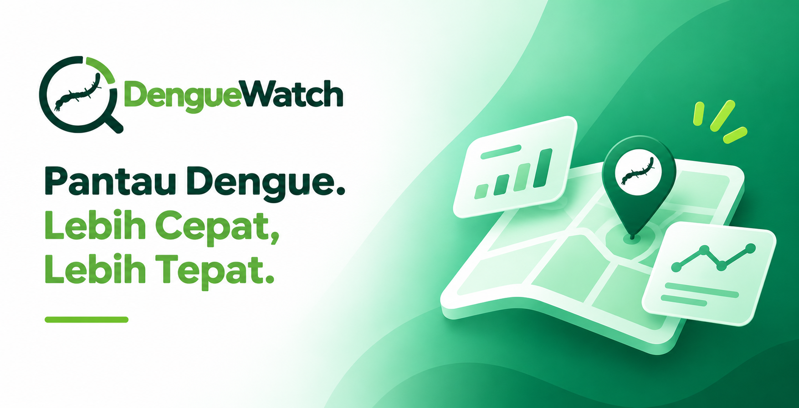
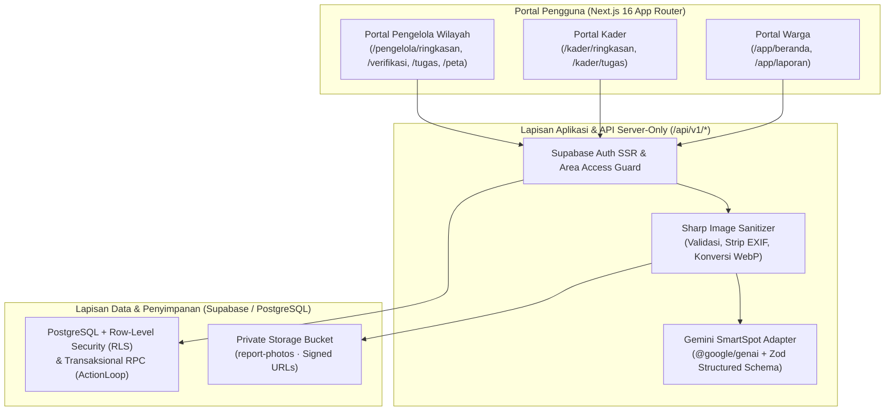

<br>
<div align="center">
  
</div>
<br>

> 🦟 **Prinsip Human-in-the-Loop & Pencegahan Berbasis Wilayah**: DengueWatch adalah platform komunitas untuk pelaporan temuan lingkungan dan tindak lanjut pemberantasan sarang nyamuk (PSN) yang terverifikasi, di mana **warga dan pengelola wilayah memegang kendali keputusan penuh**. AI (_Gemini SmartSpot_) bertindak sebagai asisten penyusun draf laporan dari foto, sementara verifikasi laporan, penugasan kader, dan persetujuan bukti penyelesaian tetap berada di tangan manusia.

---

## Apa itu DengueWatch?

**DengueWatch** adalah platform pelaporan dan penanganan risiko lingkungan demam berdarah (_dengue_) berbasis komunitas yang dirancang untuk menghubungkan **Warga**, **Pengelola Wilayah (RT/RW/Kelurahan)**, dan **Kader Lapangan (Jumantik)** dalam satu alur kerja tertutup (_closed-loop workflow_).

Di lingkungan tempat tinggal, titik-titik genangan kecil seperti wadah air terbuka, tumpukan ban bekas, maupun saluran drainase yang tersumbat sering kali terlewat atau hanya dilaporkan secara informal melalui grup pesan singkat tanpa pelacakan status, penugasan yang jelas, ataupun bukti penanganan yang terverifikasi. **DengueWatch menyelesaikan masalah ini**:

> **“Temukan. Tindak. Tuntaskan. — Genangan kecil di sekitar rumah, ditangani sampai tuntas.”**

Warga cukup memotret **1 hingga 3 foto temuan lingkungan**. Fitur **Gemini SmartSpot** secara otomatis menganalisis objek pada foto dan membantu menyusun draf kategori temuan, ringkasan objek terlihat, deskripsi laporan, serta saran pencegahan awal. Setelah laporan dikirim, **Pengelola Wilayah** memverifikasi temuan tersebut, menugaskan satu atau lebih **Kader Lapangan** dengan batas waktu (_due date_) yang jelas, serta memeriksa foto bukti penanganan dari setiap kader sebelum laporan dinyatakan selesai.

---

## Alur Pengguna Utama (_Core User Flows_)

```text
Warga (Resident):
  Daftar / Masuk Akun → Buka Buat Laporan → Unggah 1–3 Foto Temuan Lingkungan
  → (Opsional) Bantu dengan Gemini SmartSpot untuk Isi Draf Otomatis
  → Periksa & Sunting Kategori, Deskripsi, serta Titik Koordinat / Patokan Lokasi
  → Kirim Laporan → Pantau Progres 4 Tahap (Dikirim → Diperiksa → Ditangani → Selesai)
  → Lengkapi Keterangan bila Pengelola Meminta Informasi Tambahan

Pengelola Wilayah (Manager):
  Masuk Dasbor Wilayah → Pantau Peta Temuan (Titik & Kepadatan/Heatmap) + Indikator Operasional
  → Buka Antrean Verifikasi → Periksa Foto & Fakta Laporan Warga
  → Ambil Keputusan (Verifikasi / Minta Informasi / Tolak / Tandai Duplikat)
  → Buat Tugas Tindak Lanjut & Tunjuk Kader Pelaksana beserta Tenggat Penyelesaian
  → Tinjau Foto Bukti Lapangan per Kader (Setujui / Minta Perbaikan / Buka Kembali Tugas)

Kader Lapangan (Cadre):
  Masuk Portal Kader → Pantau Indikator Tugas Aktif & Tenggat Terdekat
  → Buka Detail Penugasan & Lokasi Laporan Warga → Mulai Kerjakan Tugas
  → Lakukan Penanganan di Lokasi → Unggah Foto Bukti & Catatan Tindakan Lapangan
  → Kirim Ulang Bukti Perbaikan bila Diminta Pengelola hingga Seluruh Bukti Disetujui

Pipeline Privasi Foto & Gemini SmartSpot:
  Unggah Foto (JPG/PNG/WebP ≤ 5 MiB) → Validasi & Sanitasi Server-Side (Sharp)
  → Hapus Seluruh Metadata EXIF/GPS & Konversi ke WebP (≤ 1600px)
  → Simpan di Bucket Privat (report-photos) dengan Mekanisme Lease Upload
  → Analisis Multimodal Google Gemini Flash (Validasi Skema JSON Terstruktur via Zod)
  → Draf Siap Ditinjau & Disunting Warga Sebelum Dikirim
```

---

## Fitur Unggulan (_Key Features_)

- **🤖 Gemini SmartSpot (_AI-Assisted Report Drafting_)**  
  Menganalisis foto temuan lingkungan menggunakan Google Gemini Vision untuk menyarankan kategori temuan (`Wadah air terbuka`, `Ban bekas`, `Saluran tersumbat`, atau `Temuan lain`), mengidentifikasi objek yang tampak pada foto, menyusun draf deskripsi, dan memberikan panduan pencegahan awal. Seluruh isian AI bersifat draf yang dapat diubah sepenuhnya oleh warga.
- **🔄 Alur Penanganan Tertutup (_Closed-Loop Multi-Cadre ActionLoop_)**  
  Setiap laporan yang diverifikasi pengelola wajib ditindaklanjuti melalui penugasan lapangan. Satu tugas dapat diberikan kepada satu atau beberapa kader sekaligus, dan tugas baru dinyatakan **Selesai** secara otomatis ketika bukti foto dari **setiap kader pelaksana** telah disetujui oleh pengelola.
- **🗺️ Peta Temuan Interaktif (_Spatial Clustering & Heatmap Kepadatan_)**  
  Memvisualisasikan sebaran laporan berkoordinat GPS di wilayah kelola dalam dua mode: **Mode Titik** (dengan pengelompokan otomatis/_clustering_ untuk titik yang berdekatan) dan **Mode Kepadatan (_Heatmap_)** untuk mengidentifikasi area prioritas penanganan.
- **📊 Dasbor Operasional & Analitik Wilayah (_Real-Time WIB Cohort_)**  
  Menyajikan 4 indikator operasional langsung (_Perlu verifikasi_, _Perlu penugasan_, _Tugas terlambat_, _Bukti perlu ditinjau_), daftar prioritas tindak lanjut, grafik tren laporan masuk vs selesai, serta metrik kohort tingkat penyelesaian dan median waktu penanganan (dalam jam).
- **🔒 Privasi Foto & Penghapusan EXIF Otomatis (_Privacy-by-Design_)**  
  Seluruh foto laporan warga dan foto bukti kader diproses di sisi server menggunakan `sharp` untuk menghapus metadata lokasi/perangkat (EXIF stripping), dikonversi ke format WebP yang efisien, dan disimpan di bucket privat yang hanya dapat diakses melalui _signed URL_ berbatas waktu sesuai hak akses wilayah.
- **🛡️ Isolasi Wilayah Berbasis Row-Level Security (RLS) & RPC Atomik**  
  Setiap operasi perubahan status (pembuatan laporan, keputusan verifikasi, penambahan informasi warga, penugasan kader, pengiriman bukti, hingga peninjauan bukti) dieksekusi melalui fungsi PostgreSQL RPC yang atomik dengan penegakan RLS ketat per wilayah (`area_memberships`).
- **⚡ Idempotensi & Optimistic Concurrency Control (`expected_version`)**  
  Dilengkapi kunci idempotensi (`Idempotency-Key`) untuk mencegah duplikasi pengiriman akibat jaringan tidak stabil, serta pemeriksaan versi baris (`expected_version`) untuk mencegah konflik pembaruan serentak antar-pengelola maupun kader.

---

## Tech Stack

| Lapisan                | Teknologi                                            | Keterangan                                                            |
| ---------------------- | ---------------------------------------------------- | --------------------------------------------------------------------- |
| **Framework Web**      | Next.js 16 (App Router) + React 19                   | Server Components, Server Actions, & Route Handlers RESTful           |
| **Bahasa Pemrograman** | TypeScript 5 (Strict Mode)                           | Keamanan tipe penuh dari skema database hingga komponen UI            |
| **Tampilan & Desain**  | Tailwind CSS v4 + CSS Design Tokens                  | Desain sistem utilitarian yang bersih, responsif, dan aksesibel       |
| **Ikon & Primitif UI** | Lucide Icons + Custom Accessible Controls            | Lightbox foto, stepper status, kalender, dropdown, dan tabel data     |
| **Peta & Visualisasi** | Web Mercator Tile Engine + OpenStreetMap             | Peta interaktif dengan _point clustering_, _heatmap_, dan grafik tren |
| **Mesin AI & Vision**  | Google Gemini Flash (`@google/genai`)                | Analisis citra multimodal dengan validasi JSON Schema terstruktur     |
| **Pemrosesan Citra**   | `sharp`                                              | Sanitasi EXIF metadata, rotasi otomatis, dan kompresi WebP            |
| **Database & Backend** | Supabase (PostgreSQL + Auth SSR + Storage)           | Row-Level Security (RLS), RPC transaksional, & penyimpanan privat     |
| **Validasi Skema**     | Zod v4                                               | Validasi input berlapis di sisi klien, API, dan respons AI            |
| **Pengujian Kualitas** | Vitest + Playwright + `@axe-core/playwright` + pgTAP | Uji unit, integrasi API, aksesibilitas WCAG, E2E browser, & SQL RLS   |

---

## Arsitektur Sistem (_System Architecture Overview_)



---

## Struktur Folder Proyek (_Folder Structure_)

```text
DengueWatch/
├── assets/
│   ├── brand/                 # Aset sumber logo dan mark DengueWatch
│   └── demo-reports/          # Foto sintetis untuk kebutuhan seeding demo lokal
├── docs/                      # Dokumentasi arsitektur, kontrak API, keamanan, & verifikasi
├── e2e/                       # Suite pengujian End-to-End Playwright & audit aksesibilitas Axe
├── public/                    # Aset statis publik (ikon, logo, foto tim)
├── scripts/
│   ├── seed-demo.mjs          # Skrip pembuat wilayah & 4 akun demo (warga, kader, pengelola)
│   ├── seed-report-demo.mjs   # Skrip pembuat laporan & tugas multi-tahap untuk simulasi
│   ├── cleanup-ai-analyses.mjs    # Pembersih catatan analisis AI kedaluwarsa
│   └── cleanup-report-uploads.mjs # Pembersih reservasi unggahan foto yang tidak terpakai
├── src/
│   ├── app/                   # Rute halaman Next.js App Router
│   │   ├── (auth)/            # Halaman autentikasi (/login, /daftar, /lupa-password)
│   │   ├── (resident)/        # Portal Warga (/app/beranda, /app/laporan, /app/laporan/buat)
│   │   ├── (cadre)/           # Portal Kader (/kader/ringkasan, /kader/tugas/[id])
│   │   ├── (manager)/         # Portal Pengelola (/pengelola/ringkasan, /verifikasi, /tugas, /peta)
│   │   ├── (public)/          # Halaman kebijakan privasi & syarat layanan
│   │   ├── api/v1/            # Endpoint RESTful (reports, tasks, ai/report-analyses)
│   │   └── page.tsx           # Landing page interaktif dengan layered scroll & flip cards
│   ├── components/            # Komponen antarmuka bersama (AppShell, DataTable, Lightbox, dll.)
│   ├── features/              # Modul domain fitur
│   │   ├── ai/                # Konfigurasi, skema, dan klien Gemini SmartSpot
│   │   ├── analytics/         # Query analitik wilayah & komponen DailyTrendChart
│   │   ├── areas/             # Logika otorisasi peran dan keanggotaan wilayah
│   │   ├── landing/           # Konten, gambar, dan kartu interaktif halaman depan
│   │   ├── map/               # Komponen peta interaktif FindingsMap (Titik & Kepadatan)
│   │   ├── reports/           # Form laporan, verifikasi pengelola, detail, & validasi
│   │   └── tasks/             # Daftar tugas, detail penugasan, aksi bukti kader, & validasi
│   ├── integrations/supabase/ # Klien Supabase SSR (browser, server, proxy middleware)
│   ├── lib/                   # Utilitas autentikasi, format teks, dan validasi umum
│   └── styles/                # Token desain CSS (tokens.css) dan gaya global (globals.css)
├── supabase/
│   ├── migrations/            # Migrasi SQL berurutan (skema tabel, RLS, Storage, & RPC)
│   └── tests/                 # Pengujian database dan kebijakan RLS (pgTAP / SQL assertions)
├── Denguewatch_poster.png     # Poster utama repositori DengueWatch
├── package.json               # Dependensi & skrip eksekusi proyek
├── playwright.config.ts       # Konfigurasi pengujian E2E Playwright
└── vitest.config.mts          # Konfigurasi pengujian unit & integrasi Vitest
```

---

## Panduan Menjalankan Aplikasi (_How to Run_)

### Prasyarat Sistem

- **Node.js**: v20.9+ LTS
- **pnpm**: v10+
- **Docker Desktop** (untuk menjalankan stack Supabase lokal melalui Supabase CLI)

---

### 1. Kloning Repositori & Instalasi Dependensi

```bash
git clone https://github.com/Azkasubhan/DengueWatch.git
cd DengueWatch
pnpm install
```

### 2. Konfigurasi Lingkungan (`.env.local`)

Salin file template `.env.example` menjadi `.env.local`:

```bash
cp .env.example .env.local
```

Sesuaikan nilai variabel di dalam file `.env.local`:

```dotenv
# Konfigurasi proyek Supabase (contoh untuk Supabase lokal)
NEXT_PUBLIC_SUPABASE_URL=http://127.0.0.1:54321
NEXT_PUBLIC_SUPABASE_PUBLISHABLE_KEY=sb_publishable_...

# Origin kanonik aplikasi
APP_BASE_URL=http://localhost:3000

# Kunci rahasia server-only (jangan pernah diberi prefix NEXT_PUBLIC_)
SUPABASE_SECRET_KEY=sb_secret_...
ALLOW_DEMO_SEED=true
DEMO_ACCOUNT_PASSWORD=Password123!

# Penanda mode demo pada antarmuka
NEXT_PUBLIC_DEMO_MODE=true

# Konfigurasi Gemini SmartSpot (server-only)
GEMINI_API_KEY=AIzaSy...your_gemini_api_key...
GEMINI_MODEL=gemini-2.5-flash-lite
AI_REQUEST_TIMEOUT_MS=15000
```

### 3. Menjalankan Database Lokal, Migrasi & Seed Data Demo

Pastikan Docker sudah berjalan, lalu nyalakan layanan Supabase lokal dan terapkan migrasi beserta data simulasi:

```bash
# 1. Jalankan stack Supabase lokal:
pnpm supabase:start

# 2. Terapkan seluruh migrasi SQL ke database lokal:
pnpm exec supabase migration up --local

# 3. Buat wilayah simulasi dan 4 akun demo (Warga, Kader, Pengelola):
ALLOW_DEMO_SEED=true pnpm seed:demo

# 4. Buat sampel laporan lingkungan dan tugas multi-tahap:
ALLOW_DEMO_SEED=true pnpm seed:reports
```

Daftar akun demo yang siap digunakan untuk masuk di `/login` (kata sandi sesuai `DEMO_ACCOUNT_PASSWORD`, contoh: `Password123!`):

| Peran                             | Nama Tampilan | Email                                 | Halaman Utama          |
| :-------------------------------- | :------------ | :------------------------------------ | :--------------------- |
| **Warga** (`resident`)            | Warga         | `warga.simulasi@denguewatch.test`     | `/app/beranda`         |
| **Pengelola Wilayah** (`manager`) | Pengelola     | `pengelola.simulasi@denguewatch.test` | `/pengelola/ringkasan` |
| **Kader 1** (`cadre`)             | Kader Satu    | `kader.satu@denguewatch.test`         | `/kader/ringkasan`     |
| **Kader 2** (`cadre`)             | Kader Dua     | `kader.dua@denguewatch.test`          | `/kader/ringkasan`     |

### 4. Menjalankan Server Pengembangan

```bash
pnpm dev
```

Buka peramban di **[http://localhost:3000](http://localhost:3000)**.

---

## Pengujian Kualitas Kode (_Quality Gates_)

DengueWatch dilengkapi dengan pengujian berlapis dari tingkat database hingga antarmuka peramban:

```bash
# Menjalankan seluruh pengujian unit & integrasi API (Vitest):
pnpm test

# Pemeriksaan tipe statis TypeScript:
pnpm typecheck

# Pemeriksaan kualitas kode ESLint & format Prettier:
pnpm lint
pnpm format:check

# Menjalankan pengujian kebijakan RLS, grant, & atomisitas RPC di database lokal:
pnpm test:db

# Menjalankan pengujian End-to-End & aksesibilitas (Playwright):
pnpm test:e2e

# Menguji build produksi Next.js:
pnpm build
```

---

## Cara Kerja Gemini SmartSpot & Pipeline Foto Privat

Ketika warga mengunggah foto temuan lingkungan pada halaman `/app/laporan/buat`:

1. **Sanitasi Citra & Penghapusan EXIF (`sharp`)**  
   Setiap foto divalidasi ukurannya (maksimal 5 MiB, format JPG/PNG/WebP), diputar sesuai orientasi piksel, diubah ukurannya hingga batas aman (maksimal 1600px), dihapus seluruh metadata EXIF/GPS-nya, lalu dikonversi ke format WebP.
2. **Penyimpanan Privat Berbasis Lease (`report_uploads`)**  
   Foto yang telah disanitasi disimpan di dalam bucket privat `report-photos` dan dicatat pada tabel `report_uploads`. Unggahan sementara yang tidak jadi dikirim bersama laporan dapat dibersihkan secara berkala melalui skrip `pnpm cleanup:report-uploads`.
3. **Analisis Multimodal Terstruktur (_Gemini SmartSpot_)**  
   Saat warga menekan tombol **Isi draf dari foto (AI)**, server mengirimkan citra WebP yang telah disanitasi ke model Gemini dengan skema keluaran JSON terstruktur yang divalidasi menggunakan Zod:
   - `suggestedCategory`: Kategori temuan yang paling relevan.
   - `visibleObjects`: Daftar objek nyata yang terlihat di dalam foto.
   - `draftDescription`: Draf keterangan temuan singkat untuk laporan warga.
   - `suggestedPrecaution`: Saran tindakan pencegahan awal yang aman dilakukan.
4. **Kendali Penuh Warga & Transparansi Pemeriksaan**  
   Draf dari AI langsung diisikan ke kolom formulir agar warga dapat memeriksa, menyunting, atau menggantinya sebelum menekan **Kirim laporan**. Pada halaman verifikasi pengelola, sistem menampilkan penanda transparan apabila laporan diisi dengan bantuan AI agar pengelola selalu mencocokkannya kembali dengan bukti foto.

---

## Daftar Variabel Lingkungan (_Environment Variables_)

| Variabel                               | Eksposur        | Wajib       | Keterangan                                                                 |
| -------------------------------------- | --------------- | ----------- | -------------------------------------------------------------------------- |
| `NEXT_PUBLIC_SUPABASE_URL`             | Client + Server | Ya          | URL project Supabase (lokal atau cloud)                                    |
| `NEXT_PUBLIC_SUPABASE_PUBLISHABLE_KEY` | Client + Server | Ya          | Publishable/anon key Supabase; keamanan tetap dijaga oleh RLS              |
| `APP_BASE_URL`                         | Server          | Ya          | Origin kanonik aplikasi untuk redirect email autentikasi                   |
| `SUPABASE_SECRET_KEY`                  | Server / Script | Ya          | Secret key server-only untuk staging unggahan foto & skrip seed            |
| `GEMINI_API_KEY`                       | Server          | Kondisional | API Key Google Gemini untuk fitur analisis foto SmartSpot                  |
| `GEMINI_MODEL`                         | Server          | Kondisional | Nama model Gemini yang mendukung input gambar & JSON terstruktur           |
| `AI_REQUEST_TIMEOUT_MS`                | Server          | Tidak       | Batas waktu permintaan ke Gemini API per percobaan (default: `15000` ms)   |
| `ALLOW_DEMO_SEED`                      | Script          | Tidak       | Guard eksplisit (`true`) agar skrip seed demo tidak berjalan tanpa sengaja |
| `DEMO_ACCOUNT_PASSWORD`                | Script          | Kondisional | Kata sandi untuk akun simulasi saat menjalankan `pnpm seed:demo`           |
| `NEXT_PUBLIC_DEMO_MODE`                | Client + Server | Tidak       | Menandai mode lingkungan simulasi pada antarmuka                           |

---

## Etika, Privasi & Prinsip Operasional

> DengueWatch dirancang dengan batasan operasional yang tegas demi keamanan dan kepercayaan warga:
>
> - **Bukan Alat Diagnosis Medis**: Sistem ini berfokus sepenuhnya pada **faktor risiko lingkungan fisik** (tempat perkembangbiakan nyamuk), tidak mendiagnosis penyakit demam berdarah, dan tidak menyimpan data medis pasien.
> - **Keputusan di Tangan Manusia (_Human-in-the-Loop_)**: AI hanya membantu mempercepat penulisan draf laporan dari foto. Keputusan verifikasi, penugasan lapangan, dan persetujuan bukti sepenuhnya berada di tangan pengelola wilayah.
> - **Privasi Lokasi & Foto**: Metadata EXIF pada foto dihapus secara otomatis saat diunggah, dan akses ke foto maupun rincian laporan dibatasi secara ketat berdasarkan peran dan keanggotaan wilayah.
> - **Riwayat Tercatat & Akuntabel**: Setiap perubahan status laporan dan tugas lapangan dicatat ke dalam tabel riwayat (`report_events` dan `task_events`) beserta waktu dan alasannya sehingga tidak dapat diubah secara diam-diam.

---

<br>
<div align="left">
  <h2>Meet the Team</h2>
  <p>Inovator di balik DengueWatch</p>
</div>

| <a href="#"></a> | <a href="#"></a> | <a href="#"></a> |
| :---------------------------------------------------------------------------------------------------------------------------------: | :-------------------------------------------------------------------------------------------------------------------: | :-----------------------------------------------------------------------------------------------------------------: |
|                                   <div align="center"><h3><b>Muhammad Azka Subhan</b></h3></div>                                    |                               <div align="center"><h3><b>Indra Purwanto</b></h3></div>                                |                               <div align="center"><h3><b>Calista Sahla</b></h3></div>                               |
